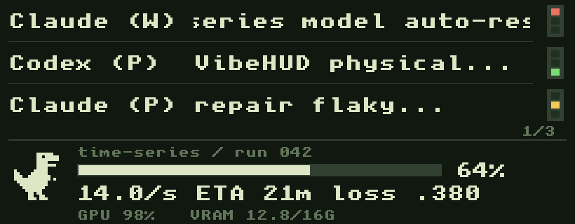

# VibeHUD

A small USB display (Waveshare **ESP32-S3-LCD-3.16**, 820×320) that shows your AI-agent sessions
(Claude Code, Codex), their usage limits, and your training runs: progress, ETA, loss curves, GPU.



How it works: a Python agent on the laptop the board is plugged into reads local files, plus remote
machines over plain `ssh`, and sends one snapshot per second over USB. Nothing is installed on remotes.

## 1. Flash the board (once)

Needs Python 3.10+ (PlatformIO). Run from the repo root, with the board plugged in:

```bash
python3 scripts/fetch_vendor.py           # downloads Waveshare's LVGL into .deps/
python3 -m venv .tools/pio && .tools/pio/bin/pip install platformio
.tools/pio/bin/pio run -t upload          # add --upload-port <port> if auto-detect picks wrong
```

If upload fails: hold BOOT, tap RST, release BOOT. Stop the agent first, it holds the serial port.

## 2. Run the agent (laptop)

```bash
python3 -m venv ~/.vibehud/venv && ~/.vibehud/venv/bin/pip install ./host
~/.vibehud/venv/bin/vibehud --once                 # prints what it sees, no board needed
~/.vibehud/venv/bin/vibehud --install-autostart    # start at login (macOS LaunchAgent, systemd, Windows)
~/.vibehud/venv/bin/vibehud --install-claude-statusline   # optional: Claude 5h/weekly limits
```

On macOS the agent runs under `caffeinate -s`, so closing the lid keeps it going **while on AC power**.
On battery the Mac sleeps anyway (`sudo pmset -a disablesleep 1` prevents that; undo with `0`).
Log: `~/.vibehud/agent.log`.

## 3. Show training runs

Any script that writes TensorBoard events to `~/runs/<project>/<exp>` shows up. That is all:

```python
writer = SummaryWriter(os.path.expanduser("~/runs/myproject/exp1"), flush_secs=5)  # default flush is 120 s
writer.add_scalar("train/loss", loss, step)       # a tag containing "loss" = train loss
writer.add_scalar("val/loss", val_loss, step)     # + "val"/"test"/"eval" = validation loss (blue)
writer.add_scalar("val/acc", val_acc, step)       # shown as "val acc 93.4%"
writer.add_scalar("vibehud/total_steps", N, 0)    # optional: progress % and ETA
```

- One run = one directory containing event files. Only the last 3 days are considered.
- Running = events in the last 150 s, stalled = up to 30 min, then done (the files cannot tell crashed from done).
- GPU/VRAM come from the machine's `nvidia-smi` and are device-wide, not per run. No GPU, no GPU line.
- **Queued runs:** list one run name per line in `~/.vibehud/queue/*.txt` (symlinks work). A run
  leaves the queue when it appears as a TensorBoard run, so a run that logs nothing vanishes once it starts.
- The board holds 24 runs: running first, then queued, then finished (the 5 newest always get a slot).

## 4. Remote machines (servers, HPC login nodes)

Add one block per machine to `~/.vibehud/config.toml` on the laptop:

```toml
runs = ["~/runs"]               # this laptop's log folders (default, may be omitted)

[[remote]]
host = "hpc-login"              # name from ~/.ssh/config, or user@host
label = "hpc"                   # prefix on screen: "hpc: myproject/exp1"
runs = ["~/runs"]               # that machine's log folders (default)
# python = "/path/to/python3"   # only if its default python3 is older than 3.9
```

Needs key-based ssh (no password prompt) and `python3` ≥ 3.9 on the remote; nothing else. The agent
sends its code through ssh and runs it from memory; it reads that machine's runs, queue, Claude/Codex
sessions and GPU, and stops when the connection ends. On a cluster, GPU data is only available where the
agent runs on a GPU node, so a login node shows no GPU line. Check the cluster allows a light, long-running
process on login nodes.

## Board controls

Short BOOT press: next page (one page per run). Hold 900 ms: toggle the 5-row sessions view.
Dino: running, resting `z` (stalled), `...` (queued), `!` (error), `+` (done).

## Repo layout and development

- `host/vibehud/` the agent: `tensorboard.py` (event-file reader), `remote.py` (ssh), `model.py` (wire format)
- `firmware/VibeHUD/` the display code (LVGL 8.4); protocol described in `host_link.h`
- `scripts/serial_hud.py`, `panel_dump.py` USB mock controls and framebuffer capture (need pyserial, Pillow)
- `examples/tensorboard_dummy.py` fake training run to test the display (`pip install tensorboardX`)

## Not tested yet

- Running the agent from a **Windows** laptop (ssh without connection sharing).
- HPC clusters (GPU on compute nodes would need `srun --jobid=<id> --overlap`).
- Linux autostart.
